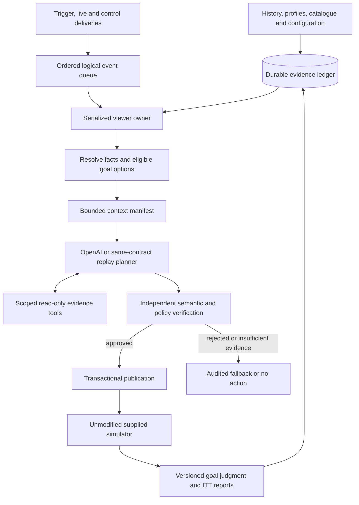
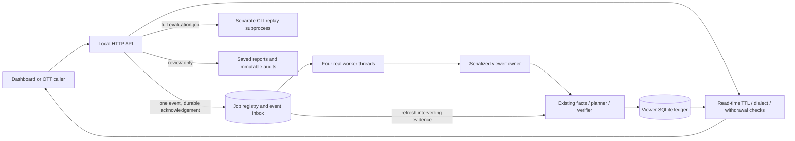

# Architecture

## Ownership and execution

One logical viewer agent owns the durable facts, current goal, single active plan, decisions, actions and observations for that viewer. This is a serialized state machine using shared workers and a shared model provider, not one process or separately trained model per viewer. SQLite transactions and unique keys enforce ownership and idempotency. JSONL and viewer-state files are inspectable exports from the ledger.

The assignment's primary decision triggers are `app_open` and `login_success`. Other delivered events update facts, reconcile the active goal, and invalidate relevant assumptions. Deadline judgment and rule/catalogue controls are code-owned. A model call is used for a meaningful planning choice, not for every event or a duplicate delivery.

## HTTP and browser layer

The FastAPI application serves the local static dashboard and OpenAPI docs. Read-only projections expose saved runs, filtered compact decisions, exact provider audits, approved title previews, viewer state and evaluation reports. The browser contains no API key and browsing cannot invoke inference. [API.md](API.md) documents the complete contracts.

Normal event integration persists only one new event; it seeds the viewer's source history once. Receipt is assigned by the server. A 202/job reference separates seconds-long inference from the later goal window. Per-viewer locks and distinct SQLite ledgers give one live owner while allowing different viewers to plan concurrently. Purchases, opt-outs and controls accepted during inference are pulled from the independent durable inbox before publication. Current page reads consult pending changes as well, so invalidation does not wait for the worker.

Live events, single supplied-trigger sandboxes and complete replay evaluations have separate state and clocks. Interactive source planning includes prior delivered facts and relevant controls within the publication window, without creating previous agent commitments. New live events cannot assume the export-to-present gap was observed: negative activity predicates stay unknown, the old profile is not proof of current subscription, and absent success signals do not prove failure without an observation watermark. Positive supported observations still update/close goals. Interactive results never enter full-run impact denominators.

The registry commits jobs before acknowledgement, retains state across restart, detects changed idempotency retries, and limits outstanding work. Restart recovers queued/running jobs; failed jobs need explicit retry. One process owns the local runtime via an OS lock; this is not distributed leadership. HTTP host/origin/body restrictions protect the local demo; production authentication and trusted event-source integration are not implemented.

## Trust boundaries

Code establishes facts and three-valued eligibility: eligible, ineligible, or unknown. Unsupported goal definitions are separate. The planner selects a goal and proposes a plan/content/channel choice from supported options, or abstains. The model cannot establish consent, invent billing, change policy, restart a retained goal's deadline, or declare an outcome succeeded.

The independent verifier checks the current authoritative context, not the model's assertion that a check passed. It can reject malformed structure, invented evidence, unsupported eligibility, a wrong or unknown dialect, unavailable content, duplicate slugs, invalid rows, ungrounded copy, unauthorized channels and daily caps. A smaller fallback is verified through the same boundary. The model has no action-execution tool.

Catalogue/search/link text is untrusted data. The context excludes unnecessary catalogue descriptions, including the supplied injection strings; this is data minimization rather than an assumption that other names or tool output are safe instructions. Scoped tools expose only the current viewer and decision boundary, bounded arguments, and relevant source data. No arbitrary SQL, shell, other-viewer lookup or external browsing is exposed.

## Memory and source handling

Facts retain source references, known-at time, freshness, conflict descriptions and a resolution rule. The original event payload and first receipt remain available in the ledger. Duplicate event IDs cannot create a second action. Snapshot rows are reconciled with event evidence; a convenient warehouse row never erases a supported purchase or opt-out.

- Current valid fresh app settings determine the dialect/language the app displays. Profile and campaign conflicts stay visible. Unknown or unsupported settings cause safe abstention rather than substitution.
- Subscription state combines profile fact time, credible purchases/renewals/lapses, and plan boundaries. Ever-paid evidence survives lapse. Expired or undated plans are not assumed currently active.
- Only explicit channel opt-in allows outbound messaging. Later opt-out overrides the snapshot.
- Progress joins title IDs to content slugs and ordered episode inventories. Language variants represent the same content for page uniqueness and progress.
- Absence-based goals require observation coverage. No event in a thirty-day export does not universally mean "never." Time-uncertain events cannot silently disappear from a negative predicate.

UTC is used for persistence; IST defines quiet hours, calendar days and habit/return rules. Server receipt/delivery governs what was knowable. Activity time is estimated by cancelling a shared phone-clock offset: `received_at - max(0, sent_at - occurred_at)`. Negative/invalid phone deltas retain uncertainty. Buffered history can update facts without being a fresh visit or a post-commit conversion.

## Context engineering and planning

Each meaningful decision builds a new structured manifest from the authoritative ledger:

1. Trigger, `as_of`, state revision, freshness and remaining budgets.
2. Resolved signup, subscription, app settings and consent facts with provenance/conflicts.
3. Relevant behavior, observation coverage, unfinished series and supported preferences.
4. Existing goal/plan/start/deadline and relevant changes.
5. Prior publications and confirmed exposure/delivery/click/failure observations.
6. Eligible goal options with proofs, exact success definitions, and reasons relevant alternatives are unknown or unsupported.
7. A small union of current-dialect available content candidates across goal options.
8. Applicable action rules, templates/pricing and an evidence index.

The prompt separates stable trusted instructions, versioned policy, and dynamic untrusted evidence. It asks the model to make an evidence-backed tradeoff while minimizing unnecessary interruption. The pack supplies no business-value weights or calibrated uplift scores; none are invented. The normal response is a structured proposal: keep/commit/replace/none, selected goal/target, concise rationale/evidence, plan/actions, review conditions, assumptions, uncertainty and confidence explanation. Hidden chain-of-thought is not requested or stored.

OpenAI's Responses API uses strict JSON schema for the proposal and bounded function calls for additional evidence. Supported read-only tools are `read_viewer_evidence`, `read_content_candidates`, `read_series_progress`, and `read_goal_rule`. Tool results inherit the viewer/as-of scope. Required evidence is never silently truncated to squeeze a call under the token cap; oversized context fails safely. The runtime records the exact manifest, provider result and check result so the model's actual contribution is visible.

Replay mode implements a documented deterministic policy behind the same proposal contract. It reproduces injected unsupported claims, malformed JSON and bounded timeout behavior through the normal rejection/fallback path. It is not presented as OpenAI intelligence or latency.

## Timing and recovery

The harness merges control events, live events, trigger deliveries and measured decision completions in a logical priority queue. Controls/evidence effective before publication are applied before publication-time revalidation. The model's trigger-time context is preserved separately from the current validation revision, so an intervening purchase, correction or withdrawal is visible.

Provider/data work is timed with the real monotonic clock. A bounded logical worker scheduler accounts for queue wait; `published_at` is trigger delivery plus measured service/validation and logical queue delay. This simulates replay scheduling from actual service measurements; it is not a real distributed throughput benchmark. Deadlines and call budgets can suppress actions even when a proposal is otherwise valid.

The configured maxima are eight model calls and twenty logical tool calls per decision, including failures and retries. Internal context reads consume part of that allowance. Dependencies have bounded timeouts; the harness injects the specified model outage and reproducible store degradation. Unsupported/malformed model output, exhausted budgets, timeouts and unavailable safety checks yield explicit verified fallback or no action. There are no hidden unbounded retries.

Pending decision jobs and state are durable. Unique decision/action IDs and daily message reservations prevent repeated publications after duplicate deliveries or resume. Reusing a goal preserves its original commitment/deadline. A new plan does not silently rewrite prior decisions. Process restarts and calls whose result is uncertain are still constrained by the persistent paid-inference ledger.

## Controls and intervention scope

G03's correction updates only still-open commitments, including those created before the correction, retaining starts/deadlines and rule history. Already-closed goals remain under their recorded rule. Indexes select affected open goals rather than reprocessing every viewer.

Withdrawals immediately remove affected candidates and invalidate affected stored plans. The simulator has no retraction action; existing exported page limitations and replacement behavior are disclosed rather than pretending a cancellation occurred. Messages are immediate-only in this version. Quiet hours cause abstention; future scheduling and durable cancellation of already-exported sends are not claimed.

Pages use configured row types and limits and disjoint content slugs across hero/rows. The platform owns Continue Watching. Push and WhatsApp share one IST-day allowance, separately from the in-app allowance. Copy is compiled from grounded canonical fields; WhatsApp uses only supported approved templates and proven variables. Delivery and exposure require confirming events.

## Outcome judgment and measurement

Goal judgments use the recorded success rule, target and original commitment window. Events must match the viewer, be credibly after commitment, and arrive within the stated observation watermark. Copied live events are deduplicated by event ID; reconstructed app opens are additionally deduplicated by viewer/session. Buffered old purchases are not new conversions. A goal without enough followup is inconclusive, not failed.

Achievement, exposure-linked success and causal impact are distinct. Home-page action IDs, message action IDs and session links support descriptive linkage. No observed link is invented for organic activity. The randomized comparison uses common predeclared seven-day play/completion/first-paid outcomes and a fourteen-day play-day metric, anchored identically to each user's first trigger delivery. All baseline users stay in their assigned arms regardless of action, failure or abstention. The first-paid cohort excludes known-paid and unknown baseline histories before treatment. Missing followup stays unknown with bounds, not silently removed from denominators.

The pilot is recomputed using randomized intention to treat; its served-versus-everyone-else headline is rejected. Live sampled runs are labelled mixed/partial demonstrations and do not stand in for a full OpenAI policy evaluation. Reports retain uncertainty and simulator limitations.

## Paid API budget

The initial local caps are USD 0.50 per live run and USD 1.00 cumulative development spend. SQLite reservations are atomic, conservative, and persistent across runs. All request input/schema framing and maximum output are reserved before dispatch; actual returned usage reconciles the reservation. Missing usage or uncertain failure billing retains its reservation. Unknown model pricing and insufficient headroom fail closed. The ledger cannot see unrelated account activity.

The user confirmed with the team that external-provider use of the dummy pack is permitted. Keys remain local. Routine regression/fault runs remain keyless, preserving the user's USD 5 credit for a small real demonstration and corrections.

Final live publication holds a short shared guard across inbox refresh, independent verification and ledger commit. Event/control acceptance uses the same guard and assigns receipt/effective time inside it. This closes the final refresh-to-publication race; external inference never holds that guard.
